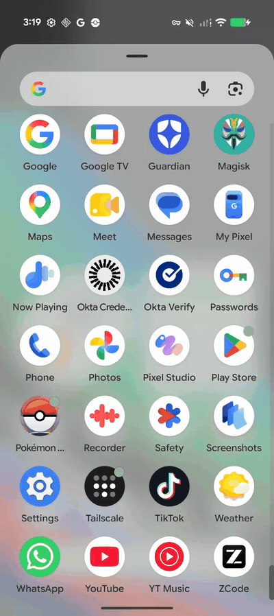

# ZCode for Android

A coding workspace that runs on your phone. Ask ZCode to change a file, review the command in chat, then open Bash and inspect the result. The chat, editor, and terminal all use the same Android workspace.

**[Download the signed ARM64 APK](https://github.com/Leoid/zcode-android/releases/latest/download/ZCode-Android-arm64.apk)** · [Release notes and checksums](https://github.com/Leoid/zcode-android/releases) · [Upstream ZCode](https://github.com/zai-org/ZCode)

<p align="center">
  
</p>

## Run it on your phone

1. Download the APK above on an ARM64 Android device. Open it and allow installation from that source if Android prompts. The workspace has been tested on a Pixel 10 running Android 16.
2. Open **ZCode → Settings → Model settings → Add provider**. Choose a preset or **Create custom provider**, then enter the base URL, API format, key, and model ID. If you see the welcome screen first, **Use API key → Skip for now** opens the workspace.
3. Start a chat. Try *“Create a hello.sh script in this workspace, run it, and show me its output.”* Review the tool request, then open **Files** to read the script or **Terminal** to run it yourself.

The app runs its own local server and agent. USB and a desktop computer are only needed for development. The configured model endpoint must be reachable from the phone. For a local inference server running on another machine, use that machine’s reachable address.

> **Coming from a development build?** The release has its own signing key. Android cannot update a debug-signed installation in place with this APK. Export any workspace files you want to keep before removing the debug app. Uninstalling clears private app data, including chat history.

## Inside the workspace

| Surface | What you can do |
| --- | --- |
| **Chats** | Reopen saved conversations, send follow-ups, review tool requests, and see results alongside the message that requested them. |
| **Files** | Create folders, edit text, import files or a project folder with the Android picker, and export individual files. |
| **Terminal** | Open an interactive Bash session. Git and ripgrep are bundled, so you can inspect diffs and search the same files the agent edits. |
| **Providers** | Use upstream presets or configure an endpoint that speaks OpenAI Chat Completions, OpenAI Responses, or Anthropic Messages. |

## How it works

The APK embeds the upstream ZCode web client, Node.js runtime, project services, and Agent CLI. The Android activity opens the client in a WebView and authenticates it to a loopback server. When a model requests a tool, the agent executes it under the app’s Android user ID. The terminal uses a native pseudo-terminal; the file browser uses Android’s document picker to move files across the sandbox boundary.

The port reuses ZCode’s chat and settings screens. Desktop-specific features such as Electron window control, desktop browser automation, and plugins with incompatible native binaries have platform limitations. Long-running jobs follow Android’s process lifecycle.

## Build from source

Clone with the upstream submodule so the build uses the same ZCode revision as this port:

```sh
git clone --recurse-submodules https://github.com/Leoid/zcode-android.git
cd zcode-android
./android/build.sh release
```

The macOS build requires Node.js and npm, Python 3, OpenSSL, a JDK 8 compiler plus a current JDK, Android SDK platform 34, build-tools 34.0.0, and an NDK with the ARM64 API 26 compiler. The release APK is written to `android/build/ZCode-Android-arm64.apk`. Your first release build creates a private key under `android/.signing/`. Back it up securely to sign future updates. For a development build, run `./android/build.sh` without an argument.

## Credits

This independent Android port is based on **[ZCode by Z.ai and the ZCode contributors](https://github.com/zai-org/ZCode)**. Their open-source project provides the client, conversation engine, project services, provider integrations, and agent tools. The [pinned upstream source](https://github.com/zai-org/ZCode/tree/a60ba6a7e5a06742270ca605f5d2cc2766afa7e1) is included as a submodule. See the upstream [Apache 2.0 license](https://github.com/zai-org/ZCode/blob/a60ba6a7e5a06742270ca605f5d2cc2766afa7e1/LICENSE), [notice](https://github.com/zai-org/ZCode/blob/a60ba6a7e5a06742270ca605f5d2cc2766afa7e1/NOTICE.md), and [third-party notices](https://github.com/zai-org/ZCode/blob/a60ba6a7e5a06742270ca605f5d2cc2766afa7e1/THIRD-PARTY-NOTICES.md).

The Android terminal uses [xterm.js](https://github.com/xtermjs/xterm.js) ([license](android/terminal/LICENSE)). The bundled ARM64 command-line runtime uses packages from [Termux](https://github.com/termux/termux-packages).
